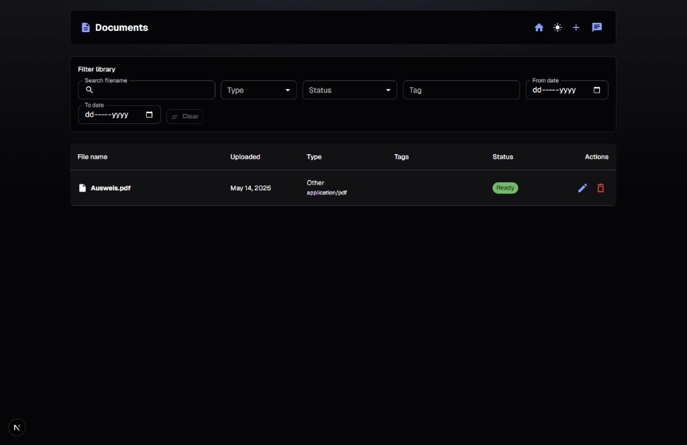
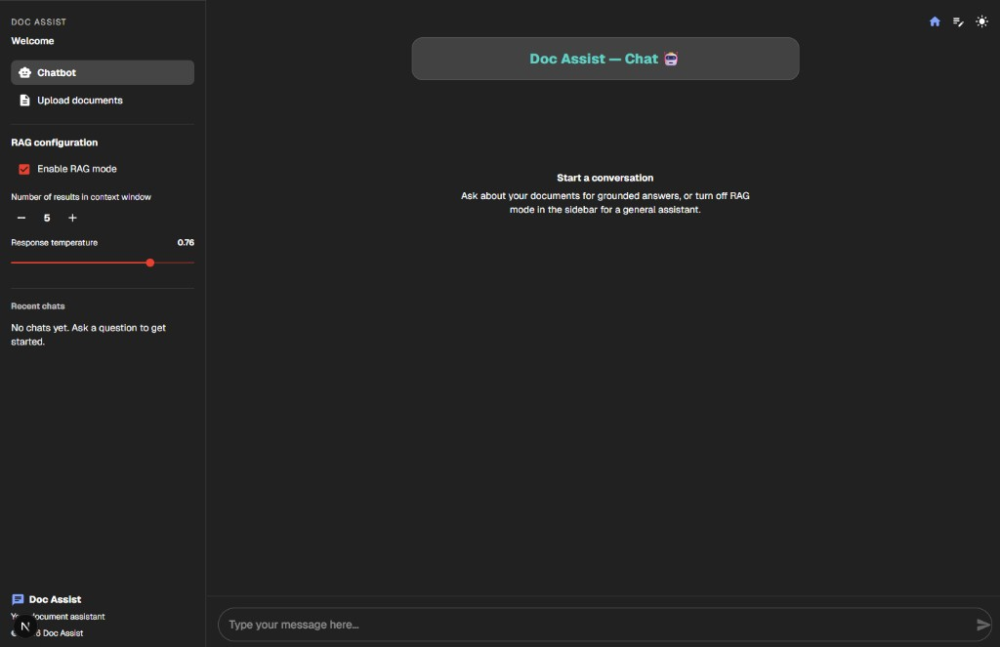

# DocAssist Monorepo

DocAssist is a retrieval-augmented assistant over your uploaded documents: a **FastAPI** backend (Docling text extraction and OCR, Postgres + pgvector hybrid search, answers from a local Ollama model) and a **Next.js** App Router frontend.

**License:** [MIT](./LICENSE) — see the [License](#license) section below.

---

## Screenshots

Dark-mode examples from the current Next.js UI:

| | |
|:--|:--|
| **Documents** (`/documents`) |  |
| **Chat** (`/chat`) |  |

---

## Repository layout

```text
Doc Assist/
├── Backend/           # FastAPI API + RAG pipeline
├── docs/screenshots/  # UI screenshots (referenced from README)
├── frontend/        # Next.js UI + `app/api/*` proxies to Backend
├── LICENSE            # MIT
├── docker-compose.yml # Optional full stack for local/demo (see SECURITY.md)
└── SECURITY.md        # Threat model and hardening notes (read before exposing to a network)
```

---

## Prerequisites

- **Python 3.11+**, **Node 20+** (matching the frontend Docker image).
- **Postgres with pgvector** reachable at `DATABASE_URL` (the `pgvector/pgvector` Docker image; `Backend/README.md` has the command).
- **Ollama** at `OLLAMA_BASE_URL` with `qwen2.5:7b` and `bge-m3` pulled.

---

## Backend quick start

```bash
cd Backend
python -m venv .venv
source .venv/bin/activate          # Windows: .\.venv\Scripts\activate
pip install torch --index-url https://download.pytorch.org/whl/cpu   # CPU-only: Docling needs torch
pip install -r requirements.txt
uvicorn src.main:app --reload --host 0.0.0.0 --port 8000
```

Start Postgres and pull the Ollama models first: see **`Backend/README.md`**.

- API: `http://localhost:8000` — OpenAPI: `/docs`
- **Environment:** only a small set of variables is read from the process environment; see `Backend/src/config.py` (`_build_settings`) and **`Backend/README.md`**. Other defaults live in **`Backend/src/constants.py`** (not env).

---

## Frontend quick start

Create **`frontend/.env.local`** (not committed):

```bash
BACKEND_API_URL=http://localhost:8000
```

```bash
cd frontend
npm install
npm run dev
```

- App: `http://localhost:3000` — routes: `/documents`, `/chat` (`/` and legacy `/queries` redirect to `/chat`).
- Quality gates: `npm run lint`, `npm run typecheck`, `npm run check` (includes `next build`).

---

## Docker (optional)

From the repo root:

```bash
docker compose build
docker compose up
```

- UI: `http://localhost:3000` — backend: `http://localhost:8000/docs`
- Compose runs Postgres with a **demo password** and expects Ollama on the host. **Do not** use that topology as-is on the public internet — read **`SECURITY.md`**.

---

## HTTP API surface (backend)

| Area        | Examples |
|------------|----------|
| Health     | `GET /health` |
| Documents  | `GET /documents` (filters: `q`, `document_type`, `status`/`inbox`, `tag`, `created_*`), `POST /documents`, `PATCH /documents/{id}` (tags), `POST /documents/extract`, `DELETE /documents/{id}` |
| Queries    | `POST /queries`, `POST /queries/stream`, `GET /queries/history` |
| Telegram   | `POST /integrations/telegram/webhook` (when bot + webhook configured) |

Full detail: **`Backend/README.md`**, **`frontend/README.md`**.

---

## Security

**Read [`SECURITY.md`](./SECURITY.md)** before deploying. The REST API does not implement per-user sign-in; treat network placement and your own reverse proxy or identity layer as your control plane for anything beyond a trusted environment.

---

## Testing and CI

**Backend** (from `Backend/`): needs a throwaway pgvector Postgres on port 5433, see **`Backend/README.md`**.

```bash
pip install -r requirements.txt -r requirements-dev.txt
pytest -q
```

**Frontend** (from `frontend/`):

```bash
npm install
npm run test
npm run check
```

**GitHub Actions**: `.github/workflows/ci.yml` runs the same checks on push/PR to `main` or `master`.

---

## Contributing

- Keep API contracts stable unless you intentionally version or document a break.
- Prefer small, reviewable changes; run **`pytest`** in `Backend/` and **`npm run check`** in `frontend/` before opening a PR.
- Update READMEs when behavior, env vars, deployment assumptions, or **prominent UI** changes (refresh `docs/screenshots/` when the documents or chat layouts change materially).

---

## License

This project is licensed under the **MIT License** — see [`LICENSE`](./LICENSE).

The `frontend/package.json` field `license` is set to `MIT` for npm tooling. The Python backend in `Backend/` is covered by the same root `LICENSE` file (no separate PyPI package is defined in-repo; if you publish one, set `license` in `pyproject.toml` to match).
